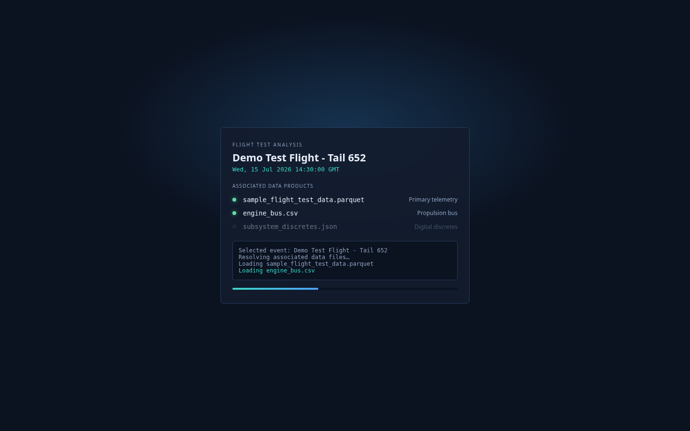
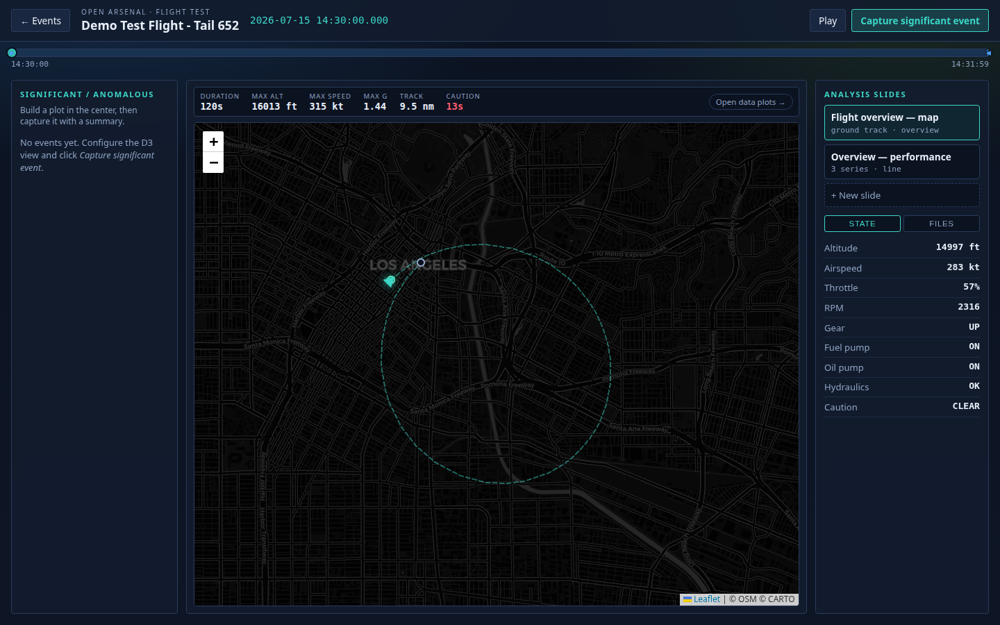
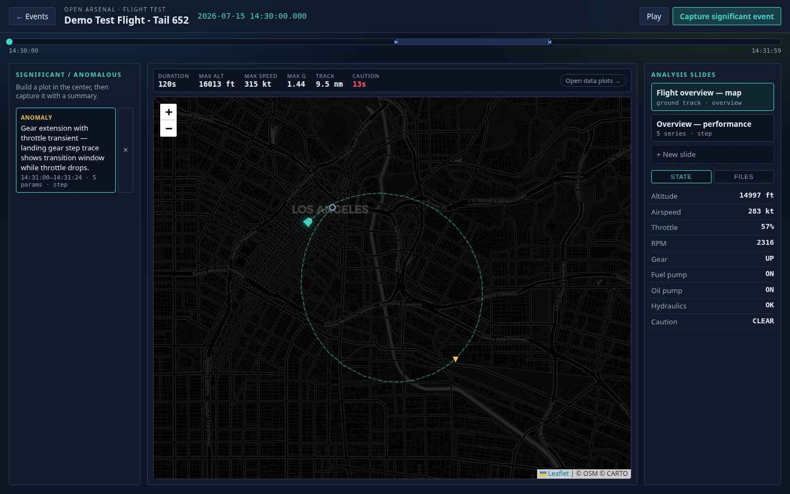
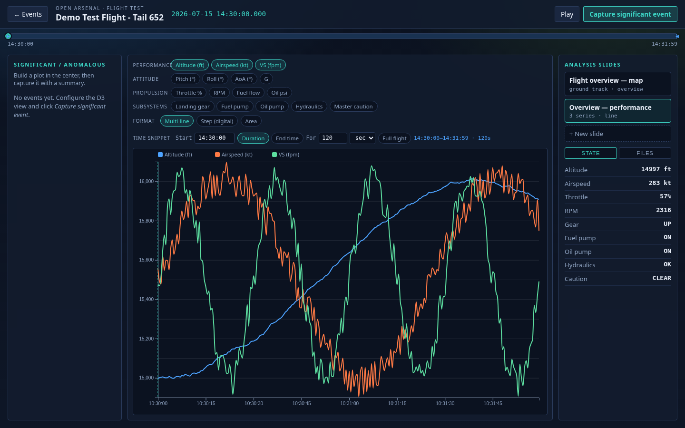
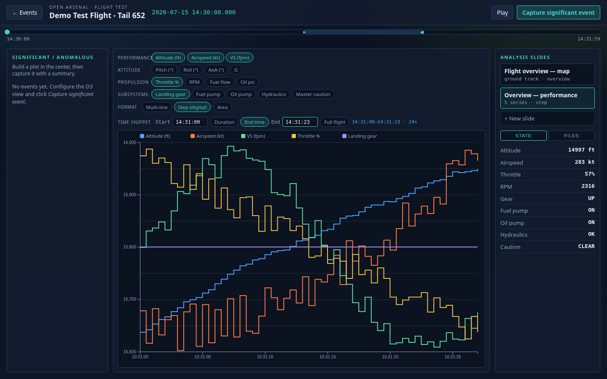
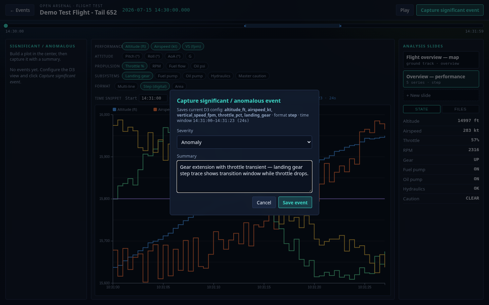
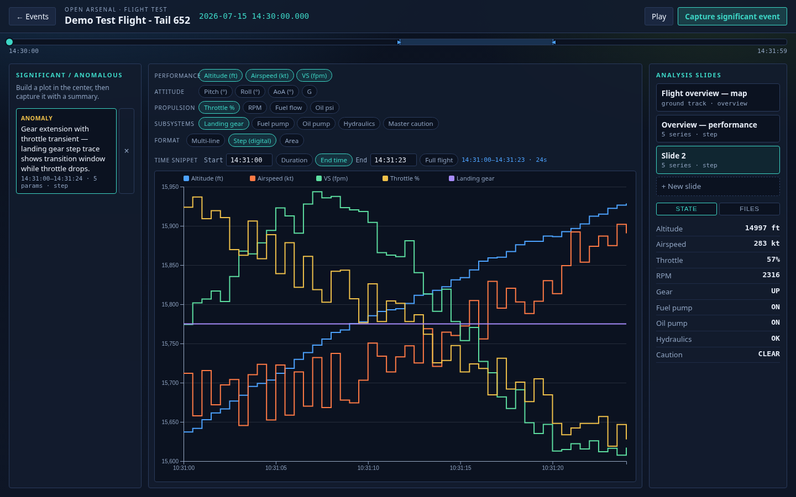
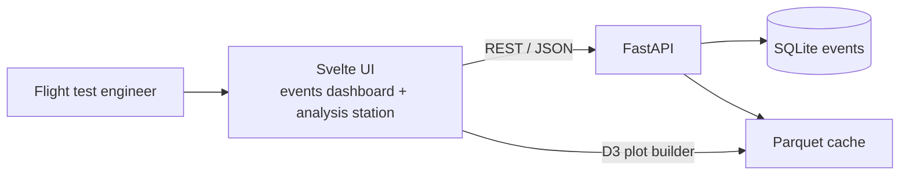
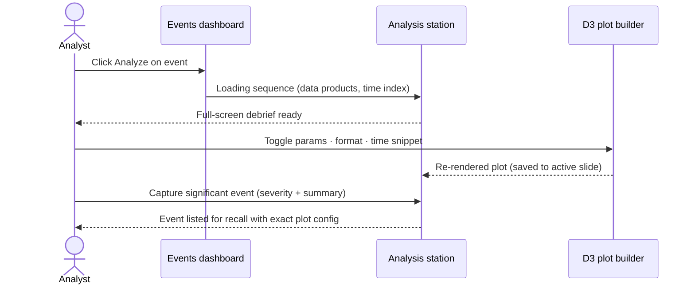

# Flight Test Data Management System

**Parquet-native flight test analysis platform with an immersive, full-screen D3 analysis station.**

Track flight test events, ingest telemetry (Parquet/CSV), and debrief flights in a
dedicated analysis station (o-my-debrief layout): a flight-overview map first, then
an interactive plot builder via analysis slides, timeline scrub with live aircraft
state, and analyst-captured significant/anomalous events.

## Screenshots

Events dashboard (demo mode):


Loading sequence — associated data products resolve before the station opens:



Flight overview map (default view) — ground track, aircraft position, event stats:



Captured anomalies appear as markers on the track; clicking one recalls its plot:



Data plots (via analysis slide) — D3 plot builder, slides, live state readout:



Step (digital) format with landing gear + throttle over a narrowed time snippet:



Capturing a significant / anomalous event with severity and summary:



Captured anomaly recalled from the left panel, second analysis slide saved:



## Architecture

Svelte frontend ↔ FastAPI backend ↔ SQLite metadata + Parquet cache. The shareable
Vercel demo is frontend-only (`VITE_DEMO_MODE`) with procedural sample data.



## Sequence — select event, debrief, capture findings



## Analysis Station (`AnalysisStation.svelte`)

- **Loading sequence** — selected event, associated data products, time index
- **Flight overview map (default)** — Leaflet map ported from o-my-debrief's
  `MissionMap`: dark CARTO tiles, dashed ground track from the location data,
  flown-track trail that follows playback, heading-rotated aircraft marker, and
  an event stats strip (duration, max alt/speed/g, track distance, caution time)
- **Plot builder (via slide)** — "Open data plots →" or the slide selector toggles
  into grouped parameter chips (Performance / Attitude / Propulsion / Subsystems)
  and formats (multi-line, step/digital, area)
- **Time snippet** — start time entry (HH:MM:SS) with either a duration offset
  (secs / mins) or an explicit end time; draggable ▶/◀ markers on the timeline
  stay in sync with the entries; "Full flight" resets the window
- **Analysis slides** — named, saved plot configurations; "+ New slide" to branch
- **Significant / anomalous events** — capture the current view with a severity
  (note / anomaly / critical) and summary; recall restores the exact configuration;
  captured events also appear as severity-colored markers on the overview map
- **Timeline** — click-to-scrub + play/pause with live state readout
  (altitude, airspeed, throttle, RPM, gear, pumps, hydraulics, master caution)

## Vercel Demo (shareable, no backend)

✅ **Frontend-only demo** — fixed sample flight (Tail 652). **Data import is disabled.**

Live: https://refactored-octo-spork-eosin.vercel.app — click **Analyze** on the
demo event to enter the analysis station.

### Deploy
1. Import repo on [vercel.com/new](https://vercel.com/new)
2. Set env `VITE_DEMO_MODE=true` (also set in `vercel.json`)
3. Deploy — build command: `cd frontend && npm install && VITE_DEMO_MODE=true npm run build`

## Sample data

```bash
python sample-data/generate_sample_flight_data.py
```

Produces CSV / JSON / Parquet (10 Hz, 22 columns: performance, attitude, propulsion,
and discrete subsystem states with gear transition, pump dropouts, and hydraulic
fault windows). Positions are a real ground track integrated from heading and
airspeed, so the map overview shows a flight circuit. The Vercel demo uses
`frontend/src/lib/demoData.js` (2 Hz procedural generator, same schema) so the
deploy stays self-contained.

## Verification

Validated 2026-08-22 against `main@836ef6e`
(see [openspec/changes/immersive-analysis-station/verification.md](openspec/changes/immersive-analysis-station/verification.md)):

- Backend pytest suite: 3 passed
- Vercel production build: succeeds
- Both data generators: 4 data-set sizes each, schema / physical-range / discrete
  use-case / round-trip checks all pass
- Full station workflow: 6/6 steps pass headless with zero console errors, on the
  local build **and** the live Vercel deployment

```bash
# workflow validation + screenshot capture
(cd frontend && npm run build && npm run preview -- --port 4199) &
UI_URL=http://localhost:4199 node scripts/capture-screenshots.mjs
```

## Local full stack

### Backend
```bash
cd backend && python3 -m venv .venv && .venv/bin/pip install -r requirements.txt "pandas<3"
cd .. && PYTHONPATH="$PWD" backend/.venv/bin/python -m uvicorn backend.main:app --reload
```

### Frontend
```bash
cd frontend && npm install && npm run dev
```

## OpenSpec / Beads

Spec-driven via OpenSpec + Gherkin + Beads:

- Specs: [openspec/specs/flight-test-data/](openspec/specs/flight-test-data/)
- Latest changes: [openspec/changes/map-overview-slide/](openspec/changes/map-overview-slide/),
  [openspec/changes/snippet-time-entry/](openspec/changes/snippet-time-entry/),
  [openspec/changes/immersive-analysis-station/](openspec/changes/immersive-analysis-station/)
- Gherkin: [features/flight-test-data.feature](features/flight-test-data.feature),
  [features/analysis-station.feature](features/analysis-station.feature)
- Roadmap: Beads issues (`bd list`) — upload, watched-directory ingest, `.mat`
  support, plot export/limits, station persistence + export

## Tech stack
- Backend: FastAPI + pandas / pyarrow
- Frontend: Svelte 5 + Vite + D3 v7 + Leaflet 1.9 (map, ported from o-my-debrief)
- Demo: static Vercel deploy, procedural sample, no import
