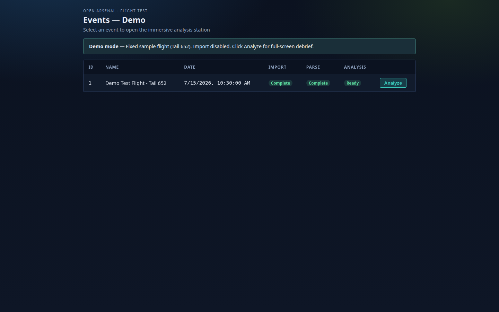
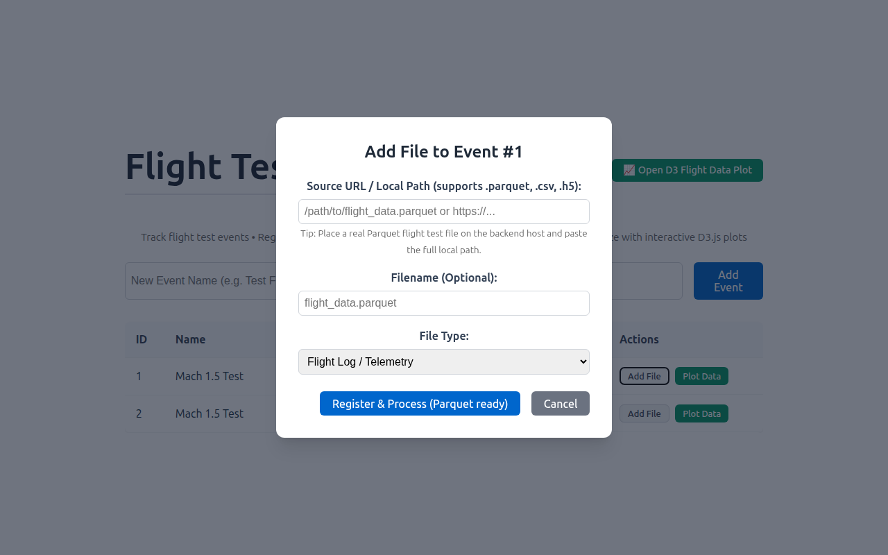
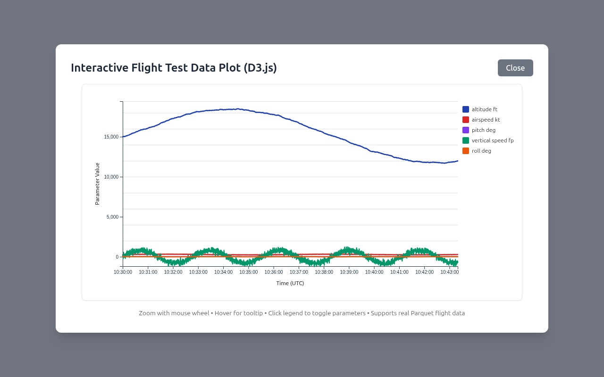

# Flight Test Data Management System

**Parquet-native flight test data platform with interactive D3.js visualization.**

This project helps aerospace teams track flight test events, ingest telemetry (Parquet/CSV first-class), and explore aircraft performance with powerful interactive plots.

## Screenshots

### Main Dashboard

### Registering a Parquet File

### Interactive D3.js Flight Data Plot

### Dashboard with Plot Modal Open

## Key Features

- Event tracking with Import / Parse / Analysis status workflow
- Register local or remote data files (excellent **Parquet** support + realistic mock generator)
- Background processing into efficient columnar Parquet cache
- REST API endpoint for downsampled data ready for visualization
- Beautiful interactive D3.js time-series plots (toggle params, tooltip, zoom/pan)

## Quick Start

See detailed instructions in the repo.

## GitHub Issues (Roadmap)

We track the next improvements as GitHub issues:

- [#3 Implement real multipart file upload](https://github.com/mowgli42/refactored-octo-spork/issues/3)
- [#4 Wire Plot Data button to actual file IDs](https://github.com/mowgli42/refactored-octo-spork/issues/4)
- [#5 Enhance D3 plot (brush, dual-axis, export)](https://github.com/mowgli42/refactored-octo-spork/issues/5)
- [#6 Watched directory auto-import scanner](https://github.com/mowgli42/refactored-octo-spork/issues/6)
- [#7 Support legacy .mat MATLAB flight test files](https://github.com/mowgli42/refactored-octo-spork/issues/7)
- [#8 Per-event file listing + multi-file comparison plots](https://github.com/mowgli42/refactored-octo-spork/issues/8)

Contributions and feedback welcome!

## Tech Stack
- Backend: FastAPI, SQLAlchemy, pandas + pyarrow
- Frontend: Svelte 5 + Vite + D3 v7
- Data: Parquet (primary), legacy HDF5/CSV support
