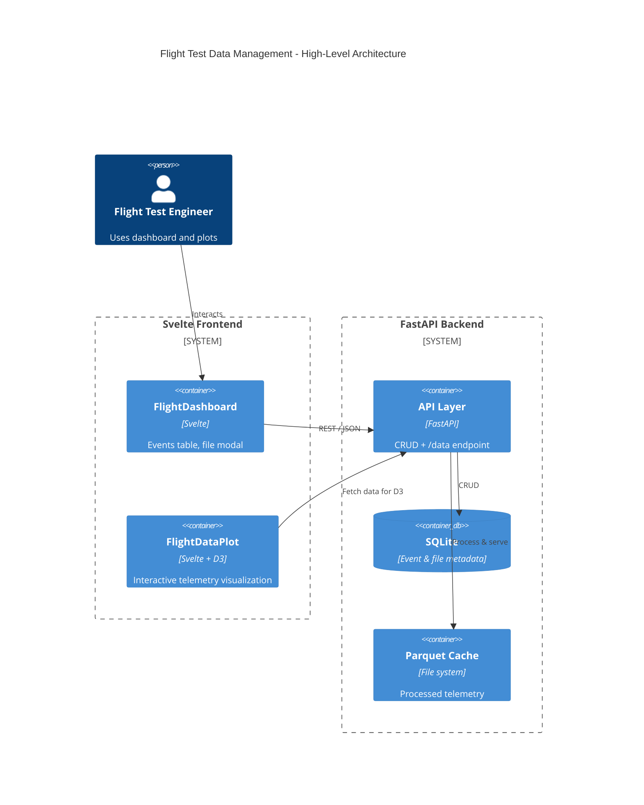
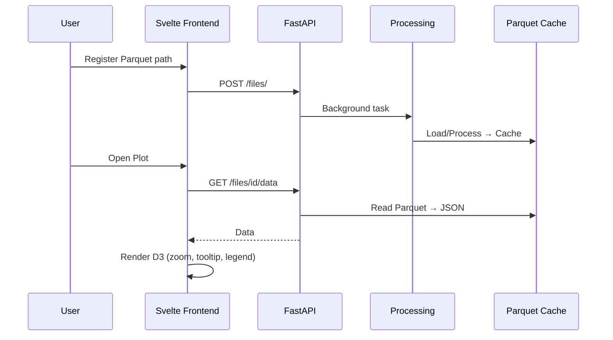

# Flight Test Data Management System

**Parquet-native flight test data platform with interactive D3.js visualization.**

This project helps aerospace teams track flight test events, ingest telemetry (Parquet/CSV first-class), and explore aircraft performance with powerful interactive plots.

## OpenSpec / Gherkin / Beads Formalization

This tool has been run through the **OpenSpec + Gherkin + Beads** spec-driven development process:
- **OpenSpec specs** (structured requirements + Gherkin scenarios) define the current capabilities and next deltas.
- **Beads** (`.beads/`) for AI-native task tracking.
- Aligned with existing GitHub issues #3–#8.

**Key OpenSpec/Gherkin Examples** (full specs in `openspec/specs/`):

```gherkin
Feature: Flight Test Data Ingestion and Visualization

  Scenario: Register and process Parquet telemetry
    Given a flight test event
    When a user registers a local .parquet file path
    Then the backend loads the data (or generates mock)
    And caches it as Parquet
    And updates statuses to Ready

  Scenario: Interactive D3 plot rendering
    Given processed telemetry data
    When the plot view loads
    Then multi-parameter time-series renders with D3
    And users can toggle series, hover for tooltips, zoom/pan
```

See `docs/architecture.md` for diagrams and full specs.

## Screenshots


## Architecture (Mermaid)


## Sequence Diagram Example (Register → Process → Plot)


## Sample Data

Realistic aircraft flight test telemetry (timestamp + key params like altitude, airspeed, pitch, roll, etc.).

- **Generated files** in `sample-data/` (CSV, JSON, script):
  - `sample_flight_test_demo.json` (500 rows — perfect for Vercel demo)
  - Full script `generate_sample_flight_data.py` for custom data.

Copy to your repo and use for testing the Parquet path or embedding in the demo.

## Vercel Demo Mode

A limited **fixed-data browser demo** is ready (no uploads, view-only sample data):

- Embedded sample JSON for events + telemetry.
- Full D3 plots work.
- Upload buttons disabled with clear messaging.

**Deploy steps**:
1. Add `DEMO_MODE=true` logic in frontend (mock data load).
2. `npm run build`.
3. Deploy via Vercel (auto-detects Svelte/Vite).

The demo is shareable instantly for stakeholders.

## Quick Start

### Backend

```bash
cd backend && python3 -m venv .venv && .venv/bin/pip install -r requirements.txt "pandas<3"
cd .. && PYTHONPATH="$PWD" backend/.venv/bin/python -m uvicorn backend.main:app --reload
```

API: `http://localhost:8000` · Swagger: `http://localhost:8000/docs`

### Frontend

```bash
cd frontend && npm install && npm run dev
```

Dashboard: `http://localhost:5173`

### Tests

```bash
PYTHONPATH="$PWD" backend/.venv/bin/python -m pytest backend/tests/ -q
(cd frontend && npm run build)
```

### Sample data

```bash
backend/.venv/bin/python sample-data/generate_sample_flight_data.py
```

Produces CSV/JSON (and Parquet when pyarrow is available) under `sample-data/`.

## Roadmap

Tracked in **Beads** (`bd list`) and GitHub issues **#3–#8**: file upload, directory scanner, plot enhancements, `.mat` support, Vercel demo mode, auth/search/export.

See [DEVELOPMENT_PLAN.md](DEVELOPMENT_PLAN.md), [BEADS.md](BEADS.md), and [openspec/specs/flight-test-data/spec.md](openspec/specs/flight-test-data/spec.md).

## Tech Stack
- Backend: FastAPI + pandas/pyarrow (Parquet-first)
- Frontend: Svelte 5 + Vite + D3 v7
- Data: Parquet cache + SQLite metadata
