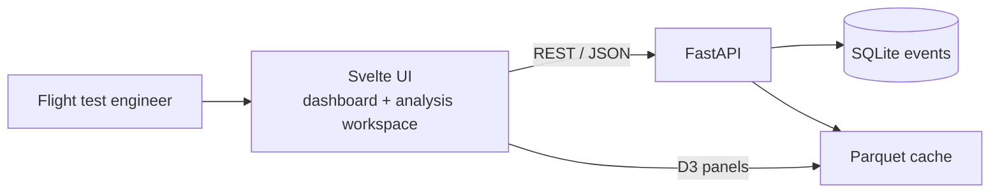
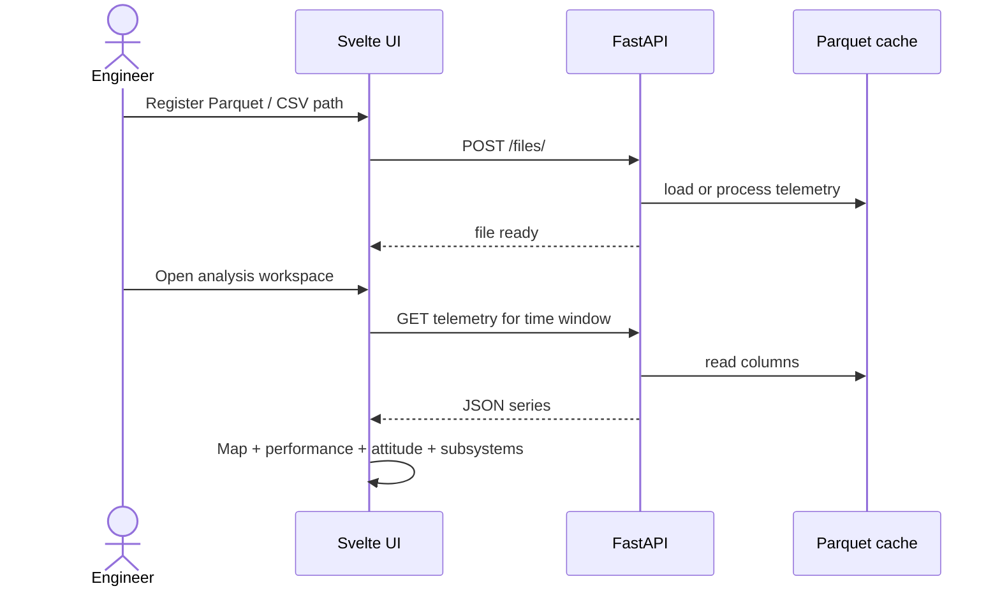

# Flight Test Data Management System

**Parquet-native flight test analysis platform with time-aligned multi-panel D3 visualization.**

Track flight test events, ingest telemetry (Parquet/CSV), and explore aircraft performance with a professional analysis workspace: map track, performance, attitude, propulsion, and subsystem digital states — all time-aligned.

## Screenshots


## Architecture

Svelte frontend ↔ FastAPI backend ↔ SQLite metadata + Parquet cache. The shareable Vercel demo is frontend-only (`VITE_DEMO_MODE`) with procedural sample data.



## Sequence — register, process, plot



## Remaining / planned

Tracked in Beads and GitHub **#3–#8** plus workspace issues **#12–#14**: multipart upload, watched-directory ingest, `.mat` support, plot export/limits, and OpenSpec deltas for the analysis workspace.

See [openspec/specs/flight-test-data/](openspec/specs/flight-test-data/) and [openspec/changes/flight-test-analysis-workspace/](openspec/changes/flight-test-analysis-workspace/).

## Vercel Demo (shareable, no backend)

✅ **Frontend-only demo** — fixed sample flight (Tail 652). **Data import is disabled.**

Live: https://refactored-octo-spork-eosin.vercel.app — open **Analysis Workspace** from the dashboard.

### What the demo shows
- **Map** — lat/lon track colored by altitude
- **Performance** — altitude, airspeed, vertical speed
- **Attitude** — pitch, roll, AoA
- **Propulsion** — throttle %, engine RPM, fuel flow
- **Subsystem states** — landing gear, fuel pump, oil pump, hydraulics, master caution (digital / step traces)
- Shared time brush + vertical cursor for correlation

### Deploy
1. Import repo on [vercel.com/new](https://vercel.com/new)
2. Set env `VITE_DEMO_MODE=true` (also set in `vercel.json`)
3. Deploy — build command: `cd frontend && npm install && VITE_DEMO_MODE=true npm run build`

## Analysis Workspace

`FlightAnalysisWorkspace.svelte` renders a linked multi-panel view:

```
Map (track)
Performance (altitude | airspeed | VS)
Attitude (pitch | roll | AoA)
Propulsion (throttle | RPM | fuel flow)
Subsystems (gear | pumps | hyd | caution)  ← digital traces
[ brush / zoom time axis ]
```

## Sample data

```bash
python sample-data/generate_sample_flight_data.py
```

Produces CSV / JSON / Parquet with continuous + discrete columns. Demo uses `frontend/src/lib/demoData.js` so Vercel stays self-contained.

## Local full stack

### Backend
```bash
cd backend && python3 -m venv .venv && .venv/bin/pip install -r requirements.txt "pandas<3"
cd .. && PYTHONPATH="$PWD" backend/.venv/bin/python -m uvicorn backend.main:app --reload
```

### Frontend
```bash
cd frontend && npm install && npm run dev
```

## OpenSpec / Beads

Spec-driven via OpenSpec + Gherkin + Beads. See `openspec/specs/flight-test-data/` and `openspec/changes/flight-test-analysis-workspace/`.

## Tech stack
- Backend: FastAPI + pandas / pyarrow
- Frontend: Svelte 5 + Vite + D3 v7
- Demo: static Vercel deploy, procedural sample, no import
