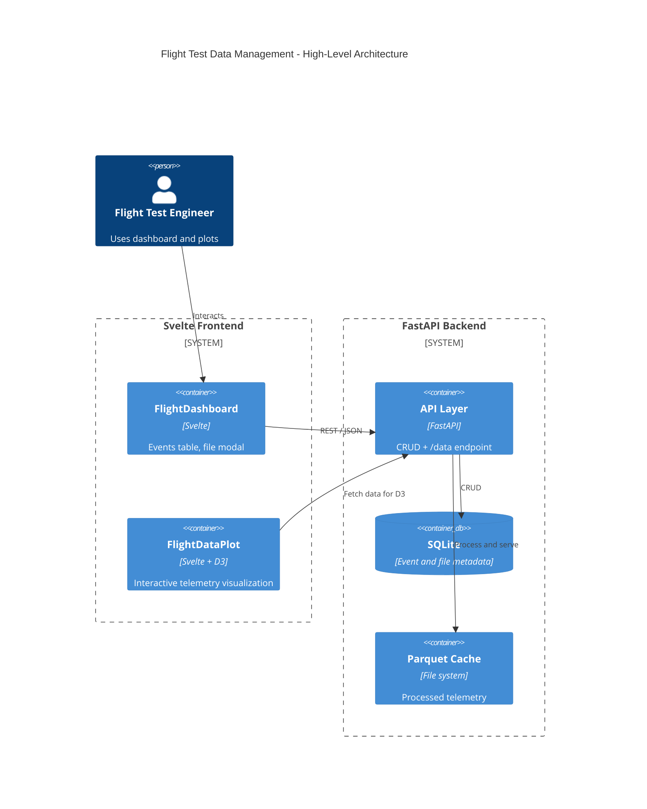
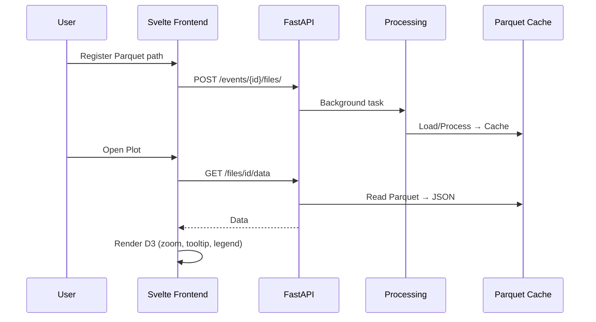

# Architecture

High-level design for the Flight Test Data Management System. Diagrams below match the README; this document adds component detail and data flow.

## Components

| Layer | Component | Role |
|-------|-----------|------|
| Frontend | `FlightDashboard.svelte` | Events table, add-event form, file registration modal, plot launcher |
| Frontend | `FlightDataPlot.svelte` | D3 multi-series chart, legend toggles, zoom/pan, tooltips |
| Backend | `main.py` | FastAPI routes: events, files, status, `/files/{id}/data` |
| Backend | `processing.py` | Load Parquet/CSV/HDF5 or mock telemetry; cache as Parquet |
| Backend | `crud.py` / `models.py` | SQLite persistence for events and file metadata |
| Data | `backend/cache/*.parquet` | Processed telemetry columnar cache |
| Data | `flight_data.db` | SQLite metadata (dev default) |

## Context diagram

## Register → process → plot sequence

## Processing rules

1. If `source_url` is a readable local path, load by extension (`.parquet`, `.csv`, `.h5`).
2. Otherwise generate mock aircraft telemetry (~8000 rows at 10 Hz).
3. Normalize `timestamp` to datetime; write Snappy-compressed Parquet to `backend/cache/{uuid}.parquet`.
4. `/files/{id}/data` downsamples by stride when rows exceed `limit` (default 3000).

## Spec and task traceability

- Living spec: `openspec/specs/flight-test-data/spec.md`
- Gherkin: `features/flight-test-data.feature`
- Tests: `backend/tests/test_api.py`
- Tasks: `.beads/` / `bd list`

## Screenshots

UI reference images live in `screenshots/`:

- `dashboard.png` — events table
- `add-file-modal.png` — file registration
- `d3-plot.png` — full-screen D3 plot
- `dashboard-with-plot.png` — plot modal over dashboard

Refresh after UI changes (see `BEADS.md`).
